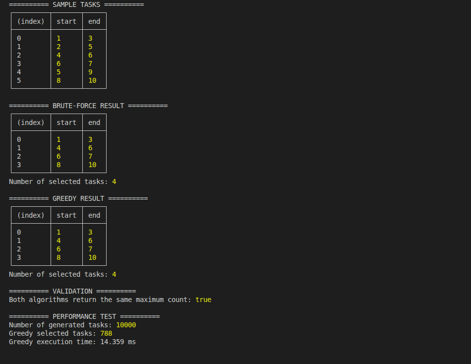
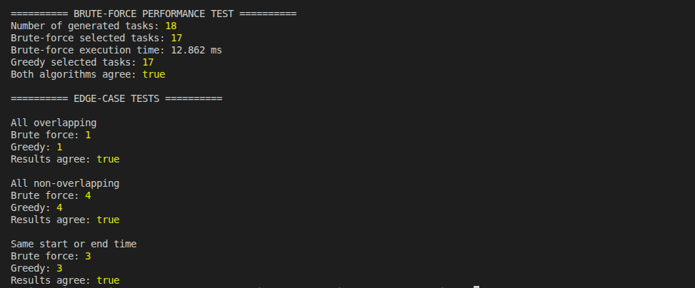

# GMC-Choosing and Defending the Best Algorithm : Brute Force vs. Greedy Algorithm

## 1. Project Overview

The Activity Selection Problem is a classic algorithmic problem in which we are given a collection of tasks, each with a start time and an end time.

The goal is to select the maximum number of tasks that can be completed without overlapping.

For example, consider the following tasks:

| Task | Start Time | End Time |
| ---- | ---------- | -------- |
| A    | 1          | 3        |
| B    | 2          | 5        |
| C    | 4          | 6        |
| D    | 6          | 7        |
| E    | 5          | 9        |
| F    | 8          | 10       |

Some tasks overlap, meaning they cannot all be selected. We need to find the largest possible set of non-overlapping tasks.

Two algorithms are implemented to solve this problem:

1. **Brute Force Algorithm**
2. **Greedy Algorithm**

The project compares their approaches, time complexities, and performance.

---

## 2. Brute Force Algorithm

### How It Works

The brute force algorithm explores different possible combinations of tasks to find the optimal solution.

For each task, it considers two possibilities:

- Exclude the task from the schedule.
- Include the task if it does not overlap with the previously selected task.

It continues exploring these possibilities until it has considered all tasks. It then keeps the schedule containing the largest number of compatible tasks.

### Advantages

- Explores all valid possibilities.
- Finds an optimal solution for the standard Activity Selection Problem.
- Provides a useful reference for checking the results of another algorithm.

### Disadvantages

- The number of possible combinations grows exponentially as the number of tasks increases.
- It becomes very slow for large datasets.
- It is impractical for real-world applications involving thousands of tasks.

### Time Complexity

**O(2ⁿ)** in the worst case, where `n` is the number of tasks.

The algorithm may explore an exponential number of combinations, making it inefficient for large inputs.

Its auxiliary space complexity is **O(n)** for the recursion stack and the currently selected tasks, excluding the returned result.

---

## 3. Greedy Algorithm

### How It Works

The greedy algorithm solves the problem by making the best local choice at each step.

It follows these steps:

1. Sort all tasks by their end time, from earliest to latest.
2. Select the task that finishes first.
3. Examine the remaining tasks in order.
4. Select a task if its start time is greater than or equal to the end time of the previously selected task.
5. Continue until all tasks have been examined.

The key idea is to choose tasks that finish as early as possible. This leaves more time available for other tasks.

### Advantages

- Efficient for large datasets.
- Easy to implement and understand.
- Finds an optimal solution for the standard Activity Selection Problem.
- Scales much better than the brute force approach.

### Disadvantages

- The choice of strategy matters: not every greedy strategy produces an optimal solution for every optimization problem.
- The earliest-finishing-time strategy is optimal for the standard Activity Selection Problem, but additional constraints may require a different algorithm.

### Time Complexity

**O(n log n)**, where `n` is the number of tasks.

Sorting the tasks takes O(n log n), while selecting compatible tasks takes O(n).

Its auxiliary space complexity is **O(n)** because the implementation creates a sorted copy and stores the selected tasks.

---

## 4. Performance Comparison

| Feature                    | Brute Force                     | Greedy                                           |
| -------------------------- | ------------------------------- | ------------------------------------------------ |
| Approach                   | Explores all valid combinations | Selects tasks based on earliest finishing time   |
| Optimal solution           | Yes                             | Yes, for the standard Activity Selection Problem |
| Worst-case time complexity | O(2ⁿ)                           | O(n log n)                                       |
| Auxiliary space complexity | O(n), excluding output          | O(n)                                             |
| Small datasets             | Suitable                        | Suitable                                         |
| Large datasets             | Impractical                     | Efficient                                        |
| Scalability                | Poor                            | Excellent                                        |

### Why Does the Greedy Algorithm Perform Better?

The brute force algorithm explores combinations of tasks, and the number of combinations grows exponentially.

The greedy algorithm avoids exploring combinations. Instead, it sorts the tasks once and examines each task in order.

As a result, the greedy algorithm can process large datasets much more efficiently.

For example, when the number of tasks doubles, the greedy algorithm's sorting cost grows relatively slowly, while the brute force algorithm's worst-case search space can grow exponentially.

---

## 5. Benchmarking

To compare performance, the program generates random tasks and measures the execution time of the algorithms.

The benchmark includes:

- Running the greedy algorithm on approximately 10,000 randomly generated tasks.
- Running the brute force algorithm on a much smaller dataset.
- Comparing the number of tasks selected by both algorithms on the same small dataset.

### Why Is the Brute Force Test Smaller?

The brute force algorithm has exponential time complexity. Running it on 10,000 tasks would be computationally impractical.

Therefore, a smaller dataset is used for brute force, while the greedy algorithm is tested on a much larger dataset.

This demonstrates the scalability difference between the two approaches.

---

## 6. Results and Correctness

For the sample dataset, both algorithms find a schedule containing four non-overlapping tasks.

This demonstrates that both implementations can find an optimal solution for the example.

The greedy algorithm is also tested with a larger randomly generated dataset to demonstrate its efficiency.

The implementation includes additional edge cases:

- **All tasks overlap:** Only one task can be selected.
- **No tasks overlap:** All tasks can be selected.
- **Tasks have identical start or end times:** The algorithm checks compatibility using start and end times.

The compatibility condition is:

`task.start >= lastEndTime`

This means a task can start exactly when the previous task finishes. Tasks that only touch at an endpoint are therefore considered non-overlapping.

The benchmark does not prove correctness for every possible input, but the algorithm's optimality follows from the standard Activity Selection Problem's greedy-choice property.

---

## 7. Which Algorithm Is Best?

**The Greedy Algorithm is the best choice for this problem when efficiency and scalability are important.**

Both algorithms can find an optimal solution for the standard Activity Selection Problem, but they differ significantly in performance.

The brute force algorithm is useful for understanding the problem and verifying results on small datasets. However, its exponential time complexity makes it unsuitable for large inputs.

The greedy algorithm achieves the same optimization goal in O(n log n) time. It is therefore the more practical solution when dealing with thousands of tasks.

### Recommendation

Use the **Greedy Algorithm** for real-world task scheduling when the objective is to maximize the number of non-overlapping tasks and each task has a fixed start and end time.

For more complex scheduling problems involving task priorities, deadlines, dependencies, or multiple resources, a different algorithm may be necessary.

---

## 8. Real-World Applications

The Activity Selection Problem can model situations where several activities compete for the same time or resource.

Examples include:

- **Meeting scheduling:** Selecting the maximum number of non-overlapping meetings in a room.
- **Task scheduling:** Organizing tasks that use a single resource.
- **Event planning:** Selecting events that do not conflict in time.
- **Resource allocation:** Scheduling activities that require exclusive access to a resource.
- **Delivery planning:** Selecting compatible time slots for deliveries, although real delivery routing may require additional constraints and algorithms.

---

## 9. Conclusion

This project demonstrates how different algorithmic approaches can solve the same optimization problem with very different performance characteristics.

The brute force algorithm explores possible combinations and provides an optimal solution, but its exponential time complexity limits its practical use.

The greedy algorithm sorts tasks by their finishing times and selects compatible tasks. For the standard Activity Selection Problem, this strategy also produces an optimal solution while requiring only O(n log n) time.

**Final conclusion:** The greedy algorithm is the preferred solution because it combines optimality with significantly better efficiency and scalability.

## Tests

